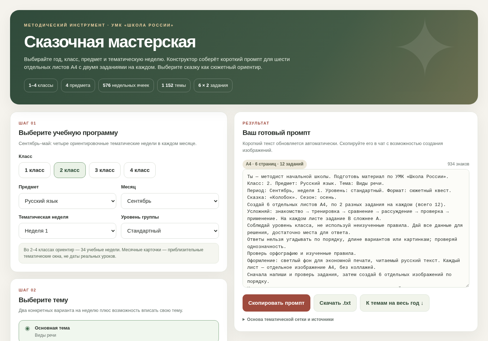

# Сказочная мастерская 🌿

**Интерактивный конструктор промптов для рабочих тетрадей 1–4 классов по темам УМК «Школа России».**

Выбирайте класс, предмет, месяц, неделю и тему — конструктор подготовит промпт для методически продуманной тетради из **6 отдельных листов А4**, по **2 задания на каждом**, с усложнением от листа к листу. В промпте указывается только название выбранной сказки и сезон — без подробного описания визуального стиля.



## 🚀 Запуск

**Без установки:** скачайте `index.html` и откройте в браузере. Приложение не требует сервера, регистрации и внешних библиотек.

**Через GitHub Pages:** после загрузки файлов в репозиторий откройте **Settings → Pages → Build and deployment → Deploy from a branch → `main` / `/(root)` → Save**. Ссылка появится на странице настроек Pages после публикации.

👉 [Подробная инструкция по загрузке на GitHub](PUBLISH_TO_GITHUB.md).

## Возможности

- **1–4 классы:** выбор класса в одном интерфейсе.
- **4 предмета:** русский язык, математика, окружающий мир, литературное чтение.
- **Сентябрь — май:** 4 тематические недели на месяц, 2 варианта темы для каждого слота, плюс собственная тема.
- **576 тематических слотов и 1152 варианта тем** в ориентировочной годовой карте.
- **Промпты:** вся тетрадь, только задания, создание изображений, один лист, отдельные ключи.
- **Дифференциация:** уровень сложности, название сказки (из списка или своё), сезон, печатный режим, тип заданий.
- **Методическая логика:** возрастные ограничения, антиугадываемость, самостоятельная проверка ответов, 6 листов с 12 заданиями.
- **1 класс:** бережный учёт добукварного и букварного периодов, когда неизвестен набор изученных букв.
- **Короткий итоговый промпт:** по умолчанию около 900–1000 знаков, без длинного арт-директорского ТЗ и требований к стилю.
- **Копирование и экспорт:** промпт копируется в буфер обмена или сохраняется в TXT.

**Важно:** конструктор создаёт *текст промпта*, а не картинки и не PDF. Сгенерированный промпт нужно передать инструменту, который умеет создавать материалы и иллюстрации.

## Пример итогового промпта

В обычном режиме промпт коротко называет класс, тему, сказку, сезон, последовательность усложнения, требования к 6 листам и проверке ответов. При выборе другой сказки меняется только её название; длинное описание персонажей, света и 3D-стиля не добавляется.

## Структура репозитория

```text
skazochnaya-masterskaya-github/
├── index.html                   # Готовое автономное веб-приложение
├── curriculum.json             # Тематическая база
├── curriculum.csv              # Темы в табличном виде (можно редактировать)
├── build_data.py               # Исходник тематической базы
├── build_html.py               # Сборка HTML со встроенными данными
├── assets/
│   └── preview.png             # Скриншот интерфейса
├── .github/workflows/check.yml # Автоматическая проверка целостности
├── .nojekyll                   # Для публикации через GitHub Pages
├── .gitignore
├── PUBLISH_TO_GITHUB.md        # Инструкция по публикации
└── README.md
```

## Как редактировать тематическую базу

Исходные темы определяются в `build_data.py`. После правок запустите в корне проекта:

```bash
python build_data.py
python build_html.py
```

Для сборки достаточно Python 3 (стандартная библиотека). `build_data.py` формирует `curriculum.json` и `curriculum.csv`, а `build_html.py` встраивает данные в `index.html` — поэтому страница работает без интернет-запросов.

## Методические ограничения

Годовая карта — **ориентировочная**, не утверждённый календарно-тематический план конкретного класса. В интерфейсе 9 месяцев × 4 условные недели, то есть 36 слотов на выбор, но это **не означает 36 фактических учебных недель**: обычно в 1 классе 33, во 2–4 классах 34. Учитель сверяет последовательность с фактическим КТП, учебным годом и изученными темами. Особенно важно уточнять освоенные буквы в 1 классе.

Содержание и ответы, предложенные генеративной моделью на основе промпта, требуют проверки педагогом. Продукт не связан с правообладателями УМК и не воспроизводит страницы учебника.

## Основания тематической карты

- [ФРП «Русский язык» (1–4 классы), 2025](https://edsoo.ru/wp-content/uploads/2025/07/2025_noo_frp_russkij-yazyk_1-4.pdf)
- [ФРП «Математика» (1–4 классы), 2025](https://edsoo.ru/wp-content/uploads/2025/07/2025_noo_frp_matematika_1-4.pdf)
- [ФРП «Окружающий мир» (1–4 классы), 2025](https://edsoo.ru/wp-content/uploads/2025/07/2025_noo_frp_okruzhayushhij-mir_1-4.pdf)
- [ФРП «Литературное чтение» (1–4 классы), 2025](https://edsoo.ru/wp-content/uploads/2025/07/2025_noo_frp_literaturnoe-chtenie_1-4.pdf)

## Права и распространение

Отдельный файл `LICENSE` не добавлен: перед открытой публикацией исходного кода владелец репозитория самостоятельно определяет условия использования и распространения. Открытый репозиторий сам по себе не означает предоставление открытой лицензии.
